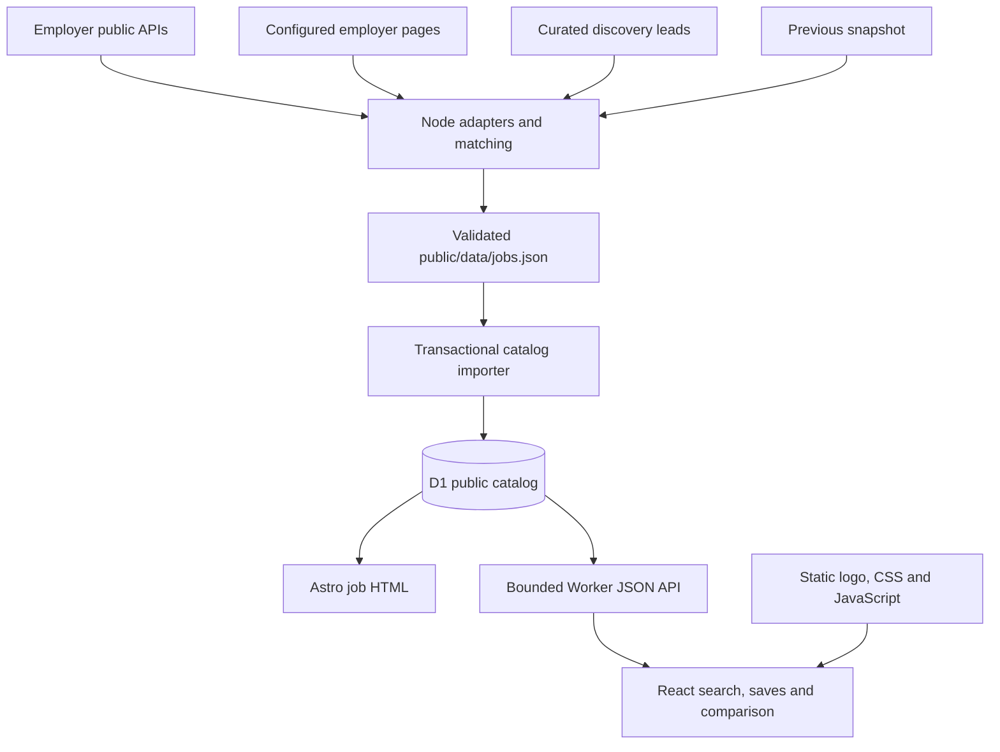

# Build your own job board with 2unemployment


Fork the project, see a working board locally, connect one employer, then publish under your own identity. You can retain the current Singapore graduate software-engineering scope, build a technology board that also includes solutions engineering, or adapt the model for communications, media and social research alongside technical work.

**This is a guide to adapting the existing application.** The shipped product still selects Singapore full-time graduate/early-career software roles. A source-list edit does not make it a general-purpose board. Sections marked **fork adaptation** describe work you must implement and test; they are not existing configuration switches.

The shell examples use Bash on macOS/Linux or a suitable Windows environment such as WSL. Start by checking the actual checkout rather than assuming every future release has the same scripts; if Git or Node is missing, use the installation links in sections 1–2 first:

```sh
node --version
git status --short
node -p "JSON.stringify(require('./package.json').scripts, null, 2)"
```

**Check:** this guide targets Node **22.23.4 or newer** and the Astro + React + D1 application described in [pipeline.md](pipeline.md). Before distributing a fork, read [licensing and data use](licensing-and-data-use.md): `package.json` declares ISC, but the repository currently lacks a `LICENSE` file. Resolve that missing grant with the maintainer before presenting the project as licensed for broad reuse. Software licensing also does not grant rights to employer descriptions, salary datasets or branding.

## 1. Make a fork you control

Git records project history like a series of labelled save points. GitHub hosts that history, review discussions and automation. A **fork** is your own GitHub copy connected to the original; a **clone** is the working copy on your computer. This makes experiments reversible and lets you propose useful improvements upstream.

Create a GitHub account, sign in, open [wilsonsfh/2unemployment](https://github.com/wilsonsfh/2unemployment), choose **Fork**, and choose your account. In your fork's **Actions** tab, leave workflows disabled initially. If already enabled, disable both **Refresh Singapore graduate jobs** and **Telegram internship alerts** using each workflow's menu. GitHub normally disables scheduled workflows in public forks; verify that state instead of depending on it. Then clone your fork, replacing `YOUR-USERNAME`:

```sh
git clone https://github.com/YOUR-USERNAME/2unemployment.git
cd 2unemployment
git remote add upstream https://github.com/wilsonsfh/2unemployment.git
git switch -c my-board-setup
git remote -v
```

**Check:** `origin` points to **your** fork and `upstream` to `wilsonsfh/2unemployment`. Actions shows no enabled inherited schedule. Do not configure Telegram credentials unless you separately want the internship watcher; it is unrelated to this board's catalog.

For Git installation, GitHub login and authentication, follow [GitHub's setup guide](https://docs.github.com/en/get-started/git-basics/set-up-git) and [fork guide](https://docs.github.com/en/pull-requests/collaborating-with-pull-requests/working-with-forks/fork-a-repo). HTTPS authentication for pushing uses GitHub's supported browser/credential-manager or token flow; your GitHub password is not a Git command password.

```sh
git --version
git branch --show-current
```

**Check:** Git prints a version and the branch is `my-board-setup`. If private repositories or paid services are involved, check your account's allowances; GitHub hosting, Actions execution, coding-agent access and Cloudflare usage have separate terms and quotas.

## 2. Set up a coding agent, if you want one

A coding agent is a collaborator that can read files, propose edits and run checks. Its account is separate from the application's runtime: this board does not call a model to collect or match jobs. You can complete these steps with an editor and terminal instead.

For Codex CLI, the [official installation guide](https://developers.openai.com/codex/cli/) currently documents this npm installation. Install Node first from [nodejs.org](https://nodejs.org/en/download), using a supported version meeting this repo's engine requirement; then run:

```sh
npm install -g @openai/codex
codex
```

**Check:** Codex opens in the repository. On first launch, choose **Sign in with ChatGPT** or another available method described by the [authentication documentation](https://developers.openai.com/codex/auth/). Check your plan's access and usage limits. No OpenAI key is needed by the job board itself. Do not paste Cloudflare, GitHub or employer-service credentials into an agent prompt.

Give any agent the project guidance explicitly. In this project, `CLAUDE.md` is canonical; also read the current state records before making changes. Start with inspection and one small outcome:

```text
Read CLAUDE.md, handover.md, progress.md, todo.md and docs/pipeline.md.
Explain the current Singapore/full-time/graduate SWE gates and data flow.
Do not edit code, publish, refresh remote data, or enable workflows yet.
Then help me run the committed snapshot locally using local D1.
```

**Check:** the explanation identifies `classify()` and `normalize()` in `scripts/lib.mjs`, the snapshot in `public/data/jobs.json`, and the D1 import. An agent that says changing `data/sources.json` alone enables every occupation has missed a core constraint.

## 3. See the existing board locally before opening cloud accounts

The checked-in snapshot lets you inspect real behavior without employer keys or Cloudflare credentials. D1 is a hosted SQLite database in production; locally Wrangler provides a separate working copy. Think of it as the board's indexed filing cabinet. Importing the snapshot fills that local cabinet; it does not refresh employer evidence or publish anything.

```sh
npm ci
npm run catalog:local
npm run dev
```

**Check:** open the `127.0.0.1` address Astro prints, usually `http://127.0.0.1:4321`. You should see jobs, original employer links, source status and salary provenance. Local D1 files live under ignored `.wrangler/`; the inherited remote database ID is not contacted by `catalog:local` because that script uses `--local`. Do not run `npm run deploy` or any `--remote` command yet.

With the server still running, use a second terminal to check the public API. This catches an unseeded database before you start debugging the interface:

```sh
curl --fail 'http://127.0.0.1:4321/api/jobs?limit=1'
curl --fail 'http://127.0.0.1:4321/api/catalog'
```

**Check:** the first response has `jobs`, `total`, `limit`, `offset`, `hasMore` and a publication `version`. The catalog response has source health and counts. A 503 usually means the catalog was not imported into the local database used by this checkout; rerun `npm run catalog:local` and restart dev. If Astro selected another port, use that port in these checks.

Try search, open a job permalink, save a job, compare roles, and use Back. Saves are browser-local IDs, so a fork does not provide accounts or cross-device application tracking. Verify the existing code before adapting it:

```sh
npm test
npm run build
npm run check
```

**Check:** tests, Astro checks/build and Wrangler's deployment dry run pass. A dry run is a packaging check, not a live deployment. Keep this working baseline as your first Git checkpoint; inspect changes before committing only the files you intend:

```sh
git status --short
git diff
```

## 4. Follow one employer feed from API to job

An API is a structured service counter: you request documented data and receive a predictable shape. This project already has adapters for public Greenhouse, Lever and Ashby job boards; those public job-list endpoints do **not** need an API key. They are different from employers' authenticated recruiting-management APIs. Use the employer's actual public board identifier, check the endpoint's terms, and do not bypass a blocked request.

The current Stripe source is an existing example in `data/sources.json`:

```json
{
  "id": "stripe",
  "name": "Stripe",
  "adapter": "greenhouse",
  "board": "stripe",
  "url": "https://boards-api.greenhouse.io/v1/boards/stripe/jobs"
}
```

**Check:** [Greenhouse Job Board API](https://developers.greenhouse.io/job-board.html), [Lever postings API](https://github.com/lever/postings-api) and [Ashby public posting API](https://developers.ashbyhq.com/docs/public-job-posting-api) describe the applicable public endpoints. Public accessibility is not a blanket republication license; see [data-use guidance](licensing-and-data-use.md).

Make one real request and pass the returned rows through the existing normalizer. Run from the repo root. This prints a small result and does not modify your snapshot:

```sh
node --input-type=module <<'NODE'
import {readFile} from 'node:fs/promises';
import {normalize} from './scripts/lib.mjs';
const sources = JSON.parse(await readFile('data/sources.json', 'utf8'));
const source = sources.find(s => s.id === 'stripe');
const response = await fetch(`${source.url}?content=true`, {
  signal: AbortSignal.timeout(25000)
});
if (!response.ok) throw Error(`HTTP ${response.status}`);
const payload = await response.json();
if (!Array.isArray(payload.jobs)) throw Error('Expected jobs array');
const jobs = payload.jobs
  .map(raw => normalize(raw, source, new Date().toISOString()))
  .filter(Boolean);
console.log({received: payload.jobs.length, matched: jobs.length});
console.log(jobs[0] && {
  id: jobs[0].id, title: jobs[0].title, location: jobs[0].location,
  eligibility: jobs[0].eligibility, sourceType: jobs[0].sourceType
});
NODE
```

**Check:** an accessible feed yields a received count. Matched can legitimately be zero because the current gates are narrow. During this guide's check on 23 November 2026, the response contained 777 rows and one match, `stripe-8160776`, Software Engineer, New Grad, Singapore. That is a dated observation, not a promised future listing or permission to reuse the description.

The following **synthetic fixture** shows the minimal compatible Greenhouse raw shape. It tests normalization without inventing a real vacancy. `normalize()` maps `absolute_url` to canonical links, converts content to plain text and retains its source. Never put this demonstration row in a published catalog:

```sh
node --input-type=module <<'NODE'
import assert from 'node:assert/strict';
import {normalize} from './scripts/lib.mjs';
const raw = {
  id: 123, title: 'Graduate Software Engineer',
  location: {name: 'Singapore'},
  absolute_url: 'https://example.com/jobs/123?utm_source=demo',
  content: '<h3>Requirements</h3><p>Experience with JavaScript.</p>'
};
const source = {id: 'demo', name: 'Demo employer', adapter: 'greenhouse'};
const job = normalize(raw, source, '2026-11-23T00:00:00.000Z');
assert.equal(job.id, 'demo-123');
assert.equal(job.category, 'swe');
assert.equal(job.eligibility, 'explicit');
assert.equal(job.applyUrl, 'https://example.com/jobs/123');
assert.equal(normalize({...raw, title: 'Communications Associate'}, source,
  '2026-11-23T00:00:00.000Z'), null);
console.log('Normalizer fixture passed; communications currently excluded.');
NODE
```

**Check:** all assertions pass. The last assertion is the reason a general board requires code changes.

For your first source, add **one** employer using an existing adapter and a stable, unique `id`; do not duplicate another employer's board token or silently change an existing ID. Greenhouse returns `{jobs: [...]}`, Lever returns an array with `text`, `categories.location` and `hostedUrl`, and Ashby returns `{jobs: [...]}` with `title`, `location`, `jobUrl`, `isListed` and `employmentType`. Ashby's current gate accepts only `isListed` and `employmentType === 'FullTime'`:

```json
{
  "id": "your-employer",
  "name": "Your employer's actual name",
  "adapter": "greenhouse",
  "board": "ACTUAL-BOARD-TOKEN",
  "url": "https://boards-api.greenhouse.io/v1/boards/ACTUAL-BOARD-TOKEN/jobs"
}
```

**Check:** replace both token placeholders with a real permitted employer board and issue one request before editing the source list. An unrecognized provider needs a new adapter and schema tests; changing the `adapter` string alone cannot make Workday or another system work. Shopee's adapter also has metadata/detail requests and a 2027 graduate query; it is not a generic ATS adapter.

Only after reviewing your source list, scope and inherited-data cleanup in the next sections, run the full refresh and inspect what changed. Ingestion writes the recovery snapshot; the second command publishes it only to local D1:

```sh
npm run ingest
npm run catalog:local
git diff --stat -- public/data/jobs.json
npm test
```

**Check:** inspect source errors and the resulting jobs. A failed source retains old jobs and their old check times. All-source failure aborts. Two successive successful absences close a managed job; a 200 response from a careers page is not proof that a vacancy is open. The importer is not another employer verification step.

## 5. Choose a truthful audience and matching policy

Separate **the work someone does** from **the employer's industry** and **the candidate's background**. A bank hires communications staff; a media company hires software engineers. Sociology can be a relevant background for research roles without being a mandatory degree. Solutions engineering is often customer-facing technical work and is not interchangeable with a senior solutions architect role.

Write a scope before asking an agent to change the gates. This is an example **planning document for your fork**, not a configuration file the application reads:

```yaml
# Proposed board scope; not implemented runtime configuration.
occupations:
  - software_engineering
  - solutions_engineering
  - communications_media
  - social_research
employer_industries: all
seniority: [entry, junior, mid, senior, unknown]
employment: [full_time, part_time, contract, internship, unknown]
locations: [Singapore]
unknown_requirements: review
degree_policy: record_explicit_requirements_without_inventing_them
```

**Check:** choose your own values deliberately. A tech-only board can select the first two occupations; a cross-discipline board can select all four or extend them. “Remote” is an arrangement, not proof someone in Singapore may work there. Store and display the employer's geographic restrictions and work-authorization wording separately.

Use explicit employer evidence for job requirements and keep uncertainty visible. The existing public `Job` contract contains the following fields; `eligibility` currently means explicit early-career wording versus review, not a candidate-specific fit score:

```ts
// Existing fields from src/types.ts; excerpt, not the complete type.
category: 'swe' | 'solutions' | 'internship';
employment: 'full-time' | 'internship';
eligibility: 'explicit' | 'review';
eligibilityNote: string;
requirements?: string[];
sourceType: 'employer-api' | 'employer-page' | 'indexed' | 'community';
sourceUrl: string;
checkedAt: string;
workRights: string;
```

**Check:** `internship` is currently mixed into the category union while employment has its own field. The normalizer nevertheless writes `category: 'swe'` and `employment: 'full-time'`. A broader fork must fix that model deliberately; type names alone do not describe implemented coverage.

**Fork adaptation:** extend the normalized public record with separate dimensions. Preserve source URLs and check times, and add evidence tied to actual employer text. The following is a proposed type sketch for your implementation, not an existing API response:

```ts
type Occupation = 'software_engineering' | 'solutions_engineering'
  | 'communications_media' | 'social_research' | 'other' | 'unknown';
type MatchEvidence = {
  field: 'occupation' | 'seniority' | 'employment' | 'location' | 'degree';
  value: string;
  quote: string;       // Exact employer wording; never a generated quotation.
  sourceUrl: string;
  checkedAt: string;
};
type BroaderJobFields = {
  occupation: Occupation;
  employerIndustry?: string;
  seniority: 'entry' | 'junior' | 'mid' | 'senior' | 'unknown';
  employment: 'full-time' | 'part-time' | 'contract' | 'internship' | 'unknown';
  evidence: MatchEvidence[];
};
```

**Check:** an employer's “degree in sociology, psychology or a related discipline” must not become “sociology degree required.” Unknown seniority stays unknown. Use this table to define a few expected outcomes before coding:

| Employer wording | Occupation evidence | Keep separate / review |
|---|---|---|
| Junior Software Engineer | Software engineering; junior title | Actual experience and geographic eligibility |
| Solutions Engineer | Solutions engineering candidate | Presales, implementation and support duties can differ; read description |
| Senior Solutions Architect | Architecture, senior | Do not classify as entry solutions engineer from the word “solutions” |
| Communications Executive | Communications candidate | Campaign/media duties, requirements and employment type |
| Research Assistant — Social Policy | Social research candidate | Methods, fieldwork, degree alternatives and contract duration |
| Research Scientist — Machine Learning | Research title is ambiguous | Do not put all “research” into sociology/social research |

Keep matching deterministic first. **Fork adaptation:** a small occupation rule can nominate a review category without claiming a person is qualified. Here is a standalone example for solutions-engineering title candidates; it does not replace the application's full classifier:

```js
function solutionsCandidate(title) {
  if (/\barchitect\b/i.test(title)) return null;
  if (/\bsolutions? engineer\b|\bsales engineer\b/i.test(title)) {
    return {occupation: 'solutions_engineering', needsRequirementsReview: true};
  }
  return null;
}
```

**Check:** add tests for `Solutions Engineer`, `Senior Solutions Engineer`, `Senior Solutions Architect` and an unrelated title. A senior solutions engineer may belong on an all-level board but must not appear as an entry-level match. Excluding architects from this example does not mean they cannot have their own occupation on your board.

## 6. Implement the broader scope across the existing stack

The current data path is already useful for a fork. Keep provenance, source-failure handling and stable IDs while changing the audience. This diagram describes implemented infrastructure; the broader taxonomy above still needs your code:



**Check:** trace one `id` from snapshot to `/api/jobs/<id>` to `/jobs/<id>`. Saved IDs depend on that stability. Astro serves readable job pages and initial search HTML; React powers the connected workspace. The original application links remain the place to apply.

For a broader board, give an agent a concrete bounded implementation task and require regression tests. This is a **fork adaptation request**, not a claim the code already supports the requested fields:

```text
Implement my written scope, preserving source provenance and stable IDs.
1. Add occupation, employer industry, seniority, employment and location
   as separate dimensions. Keep unknown values and exact requirement evidence.
2. Replace Singapore/graduate/SWE-only selection only where my scope changes it.
3. Update types, adapters, importer, SQL projections, API validation, URL state,
   filters and labels together. Do not treat a source-list edit as completion.
4. Add fixture tests for accepted, rejected and ambiguous roles, including
   communications, social research and solutions engineer versus architect.
5. Preserve source-failure timestamps, two-successful-absence closure,
   advertised-versus-estimated pay, stable links and browser-local saves.
Run npm test, npm run build and npm run check; explain remaining limits.
Do not deploy or enable schedules.
```

**Check:** review the agent's plan against these actual extension points. A source list controls which employers are fetched; it does not control these other layers:

| Layer | Existing files | Required fork review |
|---|---|---|
| Fetch and matching | `data/sources.json`, `scripts/lib.mjs`, `scripts/ingest.mjs` | Location/title gates, hardcoded SWE/full-time fields, graduate notes/cohorts/tags, provider-specific employment handling and employer-page gates |
| Manual context | `data/curated.json`, `data/employer-pages.json`, `data/salaries.json` | Remove unrelated discoveries/pages and inherited Singapore SWE salary benchmarks |
| Record contract | `src/types.ts` | Orthogonal dimensions, unknown values, evidence and broadened employment/salary currencies if required |
| SQL publication | `migrations/`, `scripts/catalog-import.mjs` | Queryable projections, indexes, search text, summary/full payloads and validation |
| Queries and public API | `src/lib/catalog.mjs`, `src/lib/catalog.d.mts`, `src/pages/api/` | Allowlisted filters, parameter binding, bounded pagination and matching counts |
| UI and URL state | `src/main.tsx`, `src/lib/workspace.mjs`, `src/lib/workspace.d.mts` | Filters, saved/compare behavior, source/salary labels, queue names and Back/Forward |
| Public pages and identity | `src/pages/index.astro`, `src/pages/jobs/[id].astro`, `src/layouts/Page.astro`, `astro.config.mjs` | Scope text, metadata, canonical URLs, branding and descriptions |
| Release verification | `scripts/verify-deployment.mjs`, `.github/workflows/refresh-jobs.yml` | Your deployment URL and the actual brand asset paths your fork retains |
| Regression checks | `tests/*.test.mjs`, existing alert tests | Taxonomy, adapters, import/query behavior and unaffected lifecycle rules |

Do not silently redefine “Graduate” to mean “all jobs.” The current catalog projects `eligibility === 'explicit'` into a `graduate` queue, and API validation accepts `graduate`, `review`, `closed` and `all`. An all-level fork needs consistent queue vocabulary through SQL, queries, counts and React. Inspect every occurrence before deciding whether to retain an early-career audience or migrate the queue contract:

```sh
rg -n 'classify|category:|employment:|graduate|Singapore|SGD|Software' \
  scripts src migrations data .github/workflows
```

**Check:** every changed label corresponds to changed behavior, and existing valid saved job IDs still resolve. If `rg` is unavailable, use your editor's repository search. Do not mass replace text: an employer description saying Singapore is source evidence, not application branding.

For SQL changes, add a migration instead of rewriting the migration history of an already deployed fork. The current tables include `jobs`, `job_cohorts`, `jobs_search`, `job_history` and `catalog_meta`; most full record fields are stored in JSON, so adding a type alone does not make a field efficiently filterable. **Fork adaptation example:** after adopting the proposed occupation field, add its projection and then update importer/query code to populate and use it:

```sql
-- Example body for a NEW migration in your fork, not shipped schema.
ALTER TABLE jobs ADD COLUMN occupation TEXT NOT NULL DEFAULT 'unknown';
CREATE INDEX jobs_queue_occupation ON jobs(queue, occupation, id);
```

**Check:** test migration and import against local D1, repeat the import, then check values and query plans. An index on an unpopulated column does not implement an occupation filter. Keep SQL parameters bound and query values allowlisted; do not interpolate browser input into SQL. The actual runtime boundary currently looks like this:

```ts
// Existing src/pages/api/jobs/index.ts, relevant lines.
import {env} from 'cloudflare:workers';
import {listJobs} from '../../../lib/catalog.mjs';
// Inside the endpoint:
await listJobs(env.DB, url.searchParams);
```

**Check:** after adaptation, verify a new filter through the real HTTP route, a reload of the same URL, Back/Forward, a saved closed role and a job permalink. Do not add a frontend-only filter that operates on just the current 25-row page while claiming to search the catalog.

## 7. Replace inherited context and identity before publishing

Use the committed catalog as a local demonstration, then replace it with your own permitted sources and honest provenance. Removing seeds alone is insufficient: `mergeFeed()` deliberately retains previous managed records, and the D1 importer deliberately retains rows absent from an import. For a clean first fork, reset the snapshot and use a fresh, fork-owned database rather than trying to delete inherited jobs through the closure mechanism.

**Fork adaptation, before your first publication:** after choosing your sources, remove inherited curated leads, configured employer pages and salary benchmarks. These commands modify your fork's data files; run them only after the initial local demonstration and save any context you intentionally want to retain separately:

```sh
node --input-type=module <<'NODE'
import {writeFile} from 'node:fs/promises';
await writeFile('data/curated.json', '[]\n');
await writeFile('data/employer-pages.json', '[]\n');
await writeFile('data/salaries.json', '{}\n');
await writeFile('public/data/jobs.json', JSON.stringify({
  generatedAt: new Date().toISOString(), jobs: [], sources: []
}, null, 2) + '\n');
NODE
```

**Check:** inspect `git diff -- data public/data/jobs.json`. The next successful `npm run ingest` must reconstruct only the sources you selected. Do not run the empty snapshot through your old D1 import and assume it deletes old rows. Changing your local database identity in section 8 gives the fork a clean database; keep its production database fresh too.

Change the Worker name, database name/ID, Astro `site`, visible name/logo, metadata and contact/provenance links before publishing. Review the supplied logo's reuse rights before retaining it; attribution to upstream does not make your new catalog upstream-verified. Salary estimates for Singapore entry SWE must not become salaries for communications, research, senior roles or other countries. Leave pay blank until you have the correct role/location/currency evidence.

```sh
rg -n '2unemployment|wilsonsoon|wilsonsfh|Singapore|SGD|graduate' \
  astro.config.mjs wrangler.jsonc package.json src public/brand \
  .github/workflows data
```

**Check:** inspect each occurrence. Preserve required source attribution and upstream acknowledgments, but change application identity, personal links, source labels, canonical site and workflow titles where appropriate. Search results are leads; retain `indexed`/review labels until original employer evidence supports a stronger claim. Never relabel copied catalogs or descriptions as your own verified employer data.

## 8. Publish to your own Cloudflare Worker and D1

The application source and tools are distinct from the hosted services. Astro, React and Wrangler are software dependencies with their own licenses; Cloudflare Workers and D1 are hosted services subject to Cloudflare's terms, quotas and pricing. GitHub and a coding-agent subscription are also separate services. No paid jobs API, model service or custom domain is required by the shipped board. Check current [Workers pricing](https://developers.cloudflare.com/workers/platform/pricing/) and [D1 pricing](https://developers.cloudflare.com/d1/platform/pricing/) before enabling traffic or automation.

Create your own Cloudflare account. From the repository, use the installed Wrangler version to sign in and confirm the account before provisioning. These commands contact Cloudflare; use them only once you are ready to create your own deployment:

```sh
npx wrangler login
npx wrangler whoami
npx wrangler d1 create my-jobs-catalog
```

**Check:** the account shown is yours. Record the new database ID returned by `d1 create`. Do not reuse `2unemployment`'s database ID. See [Wrangler commands](https://developers.cloudflare.com/workers/wrangler/commands/) and [D1 commands](https://developers.cloudflare.com/d1/wrangler-commands/).

**Fork adaptation:** keep the current Astro entry point and assets settings, but set your own Worker/database identity. The relevant portion of `wrangler.jsonc` should become the following; preserve its other existing settings. Replace the database-ID placeholder with the actual result:

```jsonc
{
  "name": "my-jobs-board",
  "d1_databases": [{
    "binding": "DB",
    "database_name": "my-jobs-catalog",
    "database_id": "REPLACE-WITH-YOUR-NEW-D1-ID",
    "migrations_dir": "migrations"
  }]
}
```

**Check:** `DB` stays the binding name because server code uses `env.DB`. In `package.json`'s `catalog:local` and `catalog:publish` scripts **and** `.github/workflows/refresh-jobs.yml`, replace the command argument `2unemployment-catalog` with `my-jobs-catalog`. Check all occurrences, including workflow migration and execute commands:

```sh
rg -n '2unemployment-catalog|database_id|database_name' \
  package.json wrangler.jsonc .github/workflows
```

**Check:** no publishing command still targets the inherited database. The changed name/ID also gives local D1 its own database identity; import your new snapshot there and inspect it before remote publication.

Set `site` in `astro.config.mjs` to your intended Worker URL, using your account's Workers subdomain. Keep the existing adapter, React integration and `session: false` configuration. This is the relevant **fork edit**, not a replacement config file:

```js
site: 'https://my-jobs-board.YOUR-WORKERS-SUBDOMAIN.workers.dev',
```

**Check:** no canonical URL points to the upstream site. If you later add a custom domain, update `site` and redeploy. A paid domain is optional. Preview your selected data locally, then run the required release gates and deploy:

```sh
npm run catalog:local
npm test
npm run build
npm run check
npm run deploy
```

**Check:** `deploy` repeats build/check, applies remote migrations, exports/imports the snapshot, then deploys the Worker. It publishes your selected catalog to your Cloudflare account. An import failure must stop deployment. Open the printed live URL and verify the catalog, one real job permalink, source links, your logo and canonical metadata:

```sh
curl --fail 'https://my-jobs-board.YOUR-WORKERS-SUBDOMAIN.workers.dev/api/catalog'
curl --fail 'https://my-jobs-board.YOUR-WORKERS-SUBDOMAIN.workers.dev/api/jobs?limit=1'
```

**Check:** use an actual returned ID to open `/jobs/<id>`. Verify full readable HTML without JavaScript, and confirm an unknown ID returns 404. A successful CLI exit alone does not prove the right snapshot or identity is live.

The repository's deployment verifier compares your local snapshot revision with live catalog/list/detail responses and checks the published logo bytes. Run it against your URL, then change the verifier URL in your fork's refresh workflow too:

```sh
node scripts/verify-deployment.mjs \
  --url https://my-jobs-board.YOUR-WORKERS-SUBDOMAIN.workers.dev
```

Build before running the verifier: it also reads every rendered `dist/client/guides/<slug>/index.html` file and compares it byte-for-byte with the published `/guides/<slug>/` page. A guide mismatch fails verification alongside a stale catalog or logo.

**Check:** it reports the expected catalog version and verified brand assets. It currently checks `public/brand/logo.svg` and `public/brand/logo-original.jpeg`; if your fork renames/removes an asset, update that asset list and its tests to match your actual branding. Otherwise a correctly deployed renamed logo will fail this check. Retain your previous Worker version, migrations and public snapshots for recovery; a Worker rollback alone cannot reverse an incompatible schema change. See [scaling and recovery](scaling.md).

## 9. Configure credentials and automation deliberately

Local Cloudflare OAuth does not sign GitHub Actions in. For unattended deployment, create a Cloudflare API token scoped to your account with the permissions in Cloudflare's **Edit Cloudflare Workers** template and **D1 Edit** for the database operations. Add repository **Actions secrets** named `CLOUDFLARE_API_TOKEN` and `CLOUDFLARE_ACCOUNT_ID` under **Settings → Secrets and variables → Actions**. Use the [official Cloudflare CI guide](https://developers.cloudflare.com/workers/ci-cd/external-cicd/github-actions/) and [GitHub secret instructions](https://docs.github.com/en/actions/how-tos/write-workflows/choose-what-workflows-do/use-secrets).

The existing deployment step reads these exact environment names:

```yaml
env:
  CLOUDFLARE_API_TOKEN: ${{ secrets.CLOUDFLARE_API_TOKEN }}
  CLOUDFLARE_ACCOUNT_ID: ${{ secrets.CLOUDFLARE_ACCOUNT_ID }}
```

**Check:** secret names appear in Settings without revealing their values. A manual workflow must actually perform both D1 import and Worker deployment to prove the token's scope. The existing workflow skips deployment when credentials are absent; a green snapshot-only run is not deployment evidence.

If you later add a credentialed provider, follow that provider's documented authentication contract. **Fork adaptation example:** a Node ingestion adapter can read a CI environment variable and send it in a server-side request. This placeholder is not a supported provider or a complete adapter:

```js
// Node ingestion only; not src/main.tsx or another browser module.
const token = process.env.JOBS_PROVIDER_TOKEN;
if (!token) throw Error('JOBS_PROVIDER_TOKEN is required for this adapter');
const response = await fetch(providerUrl, {
  headers: {Authorization: `Bearer ${token}`},
  signal: AbortSignal.timeout(25000)
});
```

**Check:** add the secret to the specific Actions step's `env` before that adapter can read it. An ignored local `.env` file is not automatically loaded by the current `node scripts/ingest.mjs` command; use an explicit local environment-loading method if needed. `PUBLIC_`/`VITE_` variables, browser bundles, snapshots, logs, prompt text and Git commits must not contain credentials. Runtime Worker secrets are a separate mechanism; the existing scheduled Node importer does not need a Worker-held provider key.

Cron is an alarm clock expressed as a schedule. This project uses **GitHub Actions schedules**, not Cloudflare Cron Triggers, to refresh data and deploy. The existing daily schedule is 23:23 UTC, or 07:23 the next day in Singapore; GitHub can delay scheduled jobs. To start safely, remove the `schedule` block from your fork's refresh workflow, retaining only manual dispatch:

```yaml
on:
  workflow_dispatch:
```

**Check:** commit/push your reviewed fork configuration and put the manual workflow on the default branch; GitHub's **Run workflow** button depends on that. Leave the separate Telegram workflow disabled. The refresh workflow needs `contents: write` to commit `public/data/jobs.json`; protected branches may need a different persistence strategy rather than relaxing protection without review.

After the isolated manual run succeeds, restore a daily schedule you want. For example, this retains the project's existing UTC time:

```yaml
on:
  workflow_dispatch:
  schedule:
    - cron: '23 23 * * *'
```

**Check:** inspect the next actual scheduled run in Actions: trigger type, ingestion/source statuses, committed snapshot, successful D1 import, deployed Worker and live catalog revision. A manual success does not prove that the future scheduled run happened. GitHub documents scheduling constraints and public-repository inactivity behavior in its [schedule reference](https://docs.github.com/en/actions/reference/workflows-and-actions/events-that-trigger-workflows#schedule).

Keep requests modest and inspect upstream changes before increasing frequency. The current ingest loop fetches sources sequentially with timeouts, retains failed-source evidence and refuses a malformed source schema. Respect 403/429 responses and provider terms; adding retries, proxies or browsers is not a permission workaround.

```sh
git log -3 --oneline -- public/data/jobs.json
git diff HEAD~1 HEAD -- public/data/jobs.json
```

**Check:** a refresh has a meaningful source/snapshot explanation, not merely newer timestamps. Failed-source records must keep their prior successful check dates, and imports/builds must never manufacture employer-verification dates. Review source health on the live board after scheduled runs.

## 10. Contribute improvements upstream

A fork can serve its own audience while contributing general fixes such as a tested public adapter, better evidence handling, accessible UI or a clearer setup step. Keep your branding, deployment IDs, credentials and private application history out of an upstream patch. Review the upstream scope before proposing a broad taxonomy change.

```sh
git fetch upstream
git switch -c improve-public-adapter upstream/main
# Make one focused change, with tests for changed behavior.
npm test
npm run build
npm run check
git diff --check
git diff
```

**Check:** the patch addresses one explainable problem, passes the project checks and contains no fork-specific database IDs or unpublished personal data. Commit the selected files, push the branch to your fork, then use GitHub's **Compare & pull request** against the upstream repository. Explain the source contract, example before/after behavior, data-use considerations and checks performed. Proposing a PR is different from claiming it has been accepted.

Your first useful milestone is small: one permitted employer feed, a clearly stated audience, honest unknowns, a readable source-linked job page, and a verified deployment owned by you. Expand occupations and employer coverage after those checks pass. Use [pipeline.md](pipeline.md) for the current ingestion/API contract, [scaling.md](scaling.md) for the architecture and recovery choices, [branding.md](branding.md) for asset publication, and [licensing and data use](licensing-and-data-use.md) before redistributing code or third-party content.
